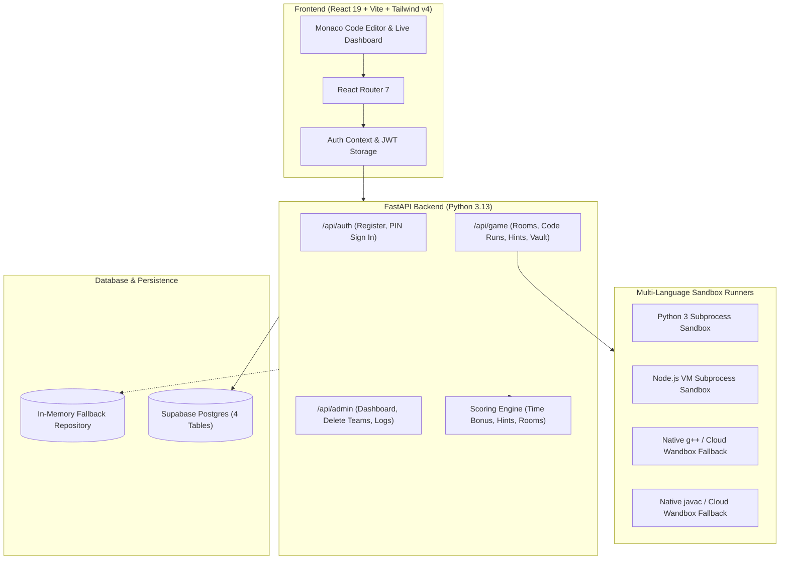

<div align="center">

# ⚡ Escape the Compiler 

**A competitive, team-based DSA escape room tournament platform.**  
*The compiler process has crashed and your team is trapped inside. Solve 5 progressive coding rooms, collect the secret vault fragments, and reboot the system before time runs out.*

[](https://react.dev/)
[](https://www.typescriptlang.org/)
[](https://tailwindcss.com/)
[](https://fastapi.tiangolo.com/)
[](https://www.python.org/)
[](https://supabase.com/)

</div>

---

## ✨ Features & Highlights

- 🌐 **Multi-Language Sandbox:** Full Monaco Code Editor and backend runner support for **C++17**, **Java**, **Python 3**, and **JavaScript** with tailored starter templates for every room.
- ☁️ **Cloud Compiler Fallback:** When deployed on serverless environments like Vercel where native `g++` or `javac` are unavailable, the runner automatically falls back to remote cloud compilers (Wandbox API) without breaking.
- 🛡️ **Anti-Hijacking & Team Security:**
  - **Zero Pre-Configuration:** Teams self-register on the spot.
  - **Team Secret PIN:** Teams set their own 4-digit PIN upon registration.
  - **Simple Sign-In Tabs:** Returning teams can quickly resume their game using just their **Team Code** and **PIN**.
  - **Impersonation Block:** Prevents unauthorized groups from using someone else's team code.
- 👥 **Dynamic Team Roster:** Supports 1 to 4 players per team with live member names displayed across game headers, team cards, and leaderboards.
- ⏱️ **Server-Authoritative Clock:** 90-minute tournament clock and strict 15-minute room countdowns. Timers, hint penalties (-20 pts each), speed bonuses, and scores are managed exclusively on the backend.
- 🏆 **Live Real-Time Leaderboard:** Dynamic leaderboard (`/leaderboard`) with top-3 podium highlights, team search, and full room progress badges.
- 🛠️ **Organizer Admin Portal:** Dedicated console at `/admin` protected by an organizer passcode to monitor teams, review live code submissions, inspect error logs, reset game timers, and delete teams.
- 🏛️ **Legacy Fallback:** The original standalone client-only version remains accessible at `/legacy`.

---

## 🧩 The Five Escape Rooms

| Room | Title | Algorithm / Concept | Output Fragment |
| :---: | :--- | :--- | :---: |
| **01** | **Stack Overflow** | Postfix / Reverse Polish Notation (`evalPostfix`) | `0x45` |
| **02** | **Rotated Search** | Modified Binary Search on Rotated Sorted Array (`searchRotated`) | `0x53` |
| **03** | **Network Trap** | Breadth-First Search (BFS) Graph Traversal (`bfs`) | `0x43` |
| **04** | **Off-By-One Anomaly** | Array Bounds & Cumulative Logic Debugging (`sumArray`) | `0x41` |
| **05** | **Cipher Lock** | Caesar / Shift Cipher Decoder (`caesarDecode`) | `0x50` |

Once all 5 rooms are completed, teams unlock the **System Vault**, assemble the 5 reboot fragments (`ESCAPE`), and trigger the system restore before the master countdown expires!

---

## 🏗️ System Architecture



---

## 🗄️ Database Schema

The database consists of **4 relational tables** in PostgreSQL:

- **`events`**: Event metadata, 90-min master timer, 15-min room timer, and active status.
- **`teams`**: Team code, team name, hashed team PIN (`pin_hash`), member list (`text[]`), score, started/escaped timestamps.
- **`room_progress`**: Tracks room status (`unopened`, `open`, `solved`), solve timestamps, and hint count per room.
- **`submissions`**: Complete audit log of every code submission, test case results, error messages, and timestamps.

---

## 🚀 Quick Start & Local Setup

### Prerequisites
- **Node.js** (v18+) & **npm**
- **Python** (v3.11+)
- *(Optional)* `g++` (for C++), `default-jdk` (for Java) — *Cloud runner automatically handles these if not installed locally.*

### 1. Clone the Repository
```bash
git clone https://github.com/your-username/escape-the-compiler.git
cd escape-the-compiler
```

### 2. Backend Setup
```bash
cd backend

# Create and activate virtual environment
python -m venv .venv

# Windows
.venv\Scripts\activate
# macOS/Linux
source .venv/bin/activate

# Install dependencies
pip install -r requirements.txt

# Configure environment variables
cp .env.example .env
```

Start the backend server:
```bash
python main.py
# Backend runs at http://localhost:8000
# OpenAPI Docs available at http://localhost:8000/docs
```

### 3. Frontend Setup
In a new terminal window:
```bash
cd frontend

# Install packages
npm install

# Configure environment
# Ensure .env or .env.local contains:
# VITE_API_URL=http://localhost:8000

# Start development server
npm run dev
# Frontend runs at http://localhost:5173
```

---

## 🧪 Testing & Verification

Run the full automated test suites to ensure everything is working:

```bash
# Backend pytest suite (32 integration tests)
cd backend
python -m pytest

# Frontend TypeScript type check
cd frontend
npm run typecheck

# Frontend unit tests
npm test

# Production build check
npm run build
```

---

## 🚢 Deployment Guide

### Vercel Deployment (Full Stack)
1. Fork or push this repository to GitHub.
2. In Vercel, import the repository.
3. Add the following Environment Variables in Vercel Project Settings:
   - `ORGANIZER_PASSCODE`: Secret passcode for the organizer portal.
   - `JWT_SECRET`: Random 32+ character string.
   - `SUPABASE_URL`: Your Supabase project URL (e.g., `https://xyz.supabase.co`).
   - `SUPABASE_SECRET_KEY`: Your Supabase service role secret key.
4. Deploy! The frontend and serverless API endpoints will be live immediately.

### Container / Docker Deployment (Render, Railway, Fly.io)
A ready-to-deploy multi-language Dockerfile is included at [`backend/Dockerfile`](backend/Dockerfile) with native `g++`, `default-jdk-headless`, `nodejs`, and `python3`:

```bash
cd backend
docker build -t escape-the-compiler-backend .
docker run -p 8000:8000 --env-file .env escape-the-compiler-backend
```

---

## 🔒 Security & Fair Play
- **Server-Authoritative Evaluation:** Test cases are stored and validated strictly on the server; clients never receive problem solutions or hidden test assertions.
- **Subprocess Isolation:** Code executions have hard memory caps and strict execution timeouts (3 seconds) to prevent infinite loops and fork bombs.
- **Row Level Security & Service Role:** All client communications go through the FastAPI backend; Supabase service role keys are never exposed in the browser bundle.

---

<div align="center">
Made with ❤️ for competitive coding hackathons and escape room tournaments.
</div>
