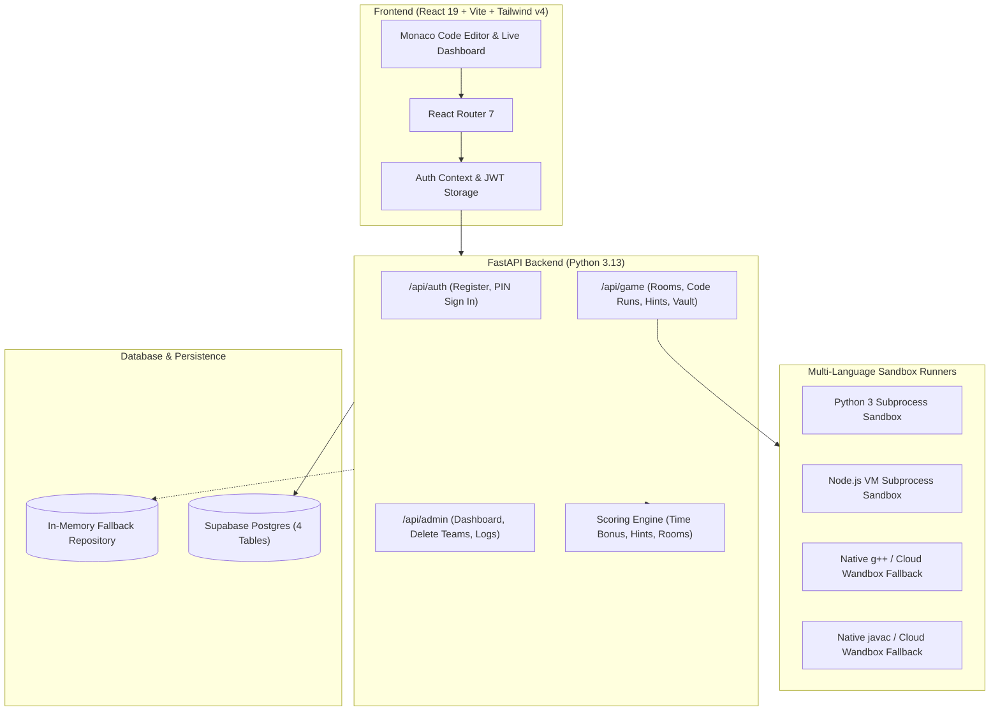

<div align="center">

# ⚡ Escape the Compiler

**A competitive, team-based DSA escape room tournament platform.**  
*The compiler process has crashed and your team is trapped inside. Solve 5 progressive coding rooms, collect the secret vault fragments, and reboot the system before time runs out.*

[](https://react.dev/)
[](https://www.typescriptlang.org/)
[](https://tailwindcss.com/)
[](https://fastapi.tiangolo.com/)
[](https://www.python.org/)
[](https://supabase.com/)

</div>

---

## ✨ Features & Highlights

- 🌐 **Multi-Language Sandbox:** Full Monaco Code Editor support for **C++17**, **Java**, **Python 3**, and **JavaScript** with starter templates and isolated test runners for every room.
- ☁️ **Cloud Compiler Fallback:** When deployed on serverless setups like Vercel where system compilers (`g++`, `javac`) aren't available, code execution seamlessly routes through Wandbox cloud runners without breaking.
- 🛡️ **Team Authentication & Anti-Hijacking:**
  - **Zero Pre-Configuration:** No need for organizers to manually create team credentials beforehand.
  - **Self-Registration:** New teams register on the spot with a Team Code, Team Name, up to 4 players, and their own 4-digit PIN.
  - **Simple Sign-In:** Returning teams can quickly resume their game using just their Team Code and PIN.
  - **Impersonation Lock:** Prevents other groups from hijacking an existing team code.
- 👥 **Team Roster:** Clean support for 1 to 4 players per team with live member names shown on headers, team cards, and leaderboards.
- ⏱️ **Server-Authoritative Timing:** A 90-minute tournament clock and 15-minute room countdowns. Timers, hint penalties (-20 pts each), speed bonuses, and scores are managed strictly on the backend.
- 🏆 **Live Real-Time Leaderboard:** Dynamic scoreboard featuring top-3 podium highlights, team search, and per-room solve badges.
- 🛠️ **Organizer Admin Console:** A password-protected `/admin` dashboard to monitor teams, review live submissions and error logs, reset timers, and delete teams.
- 🏛️ **Legacy Fallback:** The original standalone client-only version remains accessible at `/legacy`.

---

## 🧩 The Five Escape Rooms

| Room | Title | Algorithm / Concept | Output Fragment |
| :---: | :--- | :--- | :---: |
| **01** | **Stack Overflow** | Postfix / Reverse Polish Notation (`evalPostfix`) | `0x45` |
| **02** | **Rotated Search** | Modified Binary Search on Rotated Sorted Array (`searchRotated`) | `0x53` |
| **03** | **Network Trap** | Breadth-First Search (BFS) Graph Traversal (`bfs`) | `0x43` |
| **04** | **Off-By-One Anomaly** | Array Bounds & Cumulative Logic Debugging (`sumArray`) | `0x41` |
| **05** | **Cipher Lock** | Caesar / Shift Cipher Decoder (`caesarDecode`) | `0x50` |

Once all 5 rooms are completed, teams unlock the **System Vault**, assemble the 5 reboot fragments (`ESCAPE`), and trigger the system restore before the countdown expires.

---

## 🏗️ Architecture



---

## 🗄️ Database Schema

The database consists of **4 relational tables** in PostgreSQL:

- **`events`**: Tournament metadata, 90-min master timer, 15-min room timer, and active status.
- **`teams`**: Team code, team name, hashed team PIN (`pin_hash`), member list (`text[]`), score, started/escaped timestamps.
- **`room_progress`**: Tracks room status (`unopened`, `open`, `solved`), solve timestamps, and hint count per room.
- **`submissions`**: Complete audit log of every code submission, test case results, error messages, and timestamps.

---

## 🚀 Getting Started

### Prerequisites
- **Node.js 18+** and **npm**
- **Python 3.11+**
- *(Optional)* `g++` and `default-jdk` — *Cloud runner automatically handles these if not installed locally.*

### 1. Clone the Repository
```bash
git clone https://github.com/your-username/escape-the-compiler.git
cd escape-the-compiler
```

### 2. Backend Setup
```bash
cd backend

# Create and activate virtual environment
python -m venv .venv

# Windows
.venv\Scripts\activate
# macOS/Linux
source .venv/bin/activate

# Install dependencies
pip install -r requirements.txt

# Configure environment variables
cp .env.example .env

# Run the backend
python main.py
```
The API will run at `http://localhost:8000`. OpenAPI documentation is available at `http://localhost:8000/docs`.

### 3. Frontend Setup
In a new terminal:
```bash
cd frontend

# Install packages
npm install

# Start development server
npm run dev
```
The app will run at `http://localhost:5173`.

---

## 🧪 Testing

```bash
# Run backend pytest suite (32 integration tests)
cd backend
python -m pytest

# Run frontend type check & unit tests
cd frontend
npm run typecheck
npm test
```

---

<div align="center">

Made with ❤️ for the DSA community

</div>
